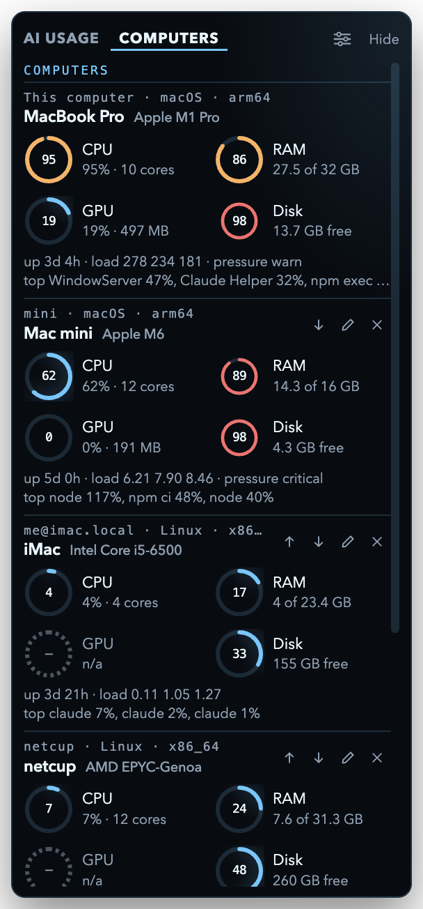
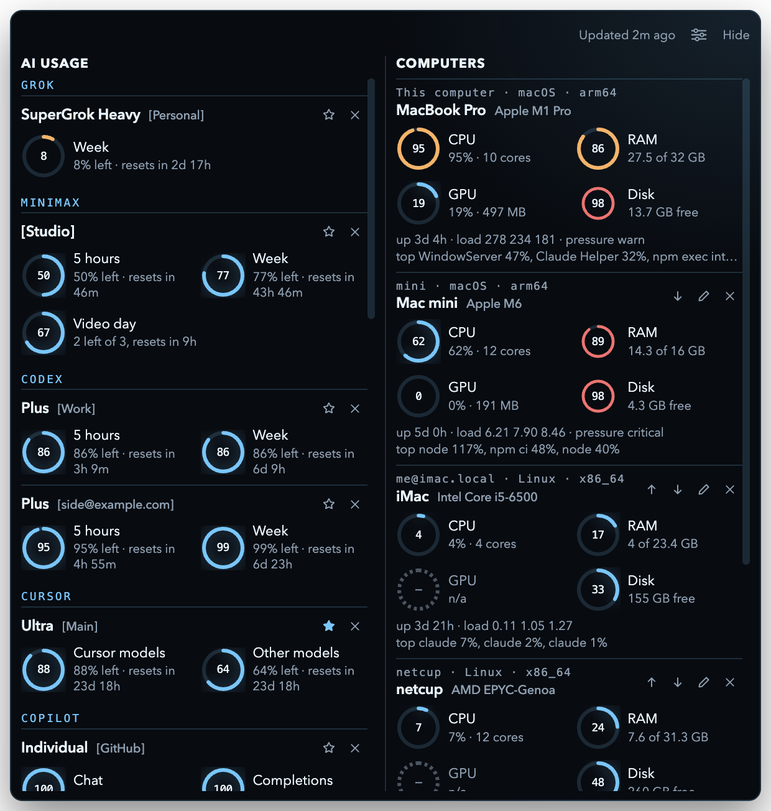

# Usage Monitor

[](https://hol.org/registry/plugins/errr0rr404%2Fusage-monitor)

A small floating desktop meter for Grok, MiniMax, Codex, Claude, Cursor, Copilot, Gemini (Antigravity), Muse, OpenCode, DeepSeek, OpenRouter, Kimi Code, the Kimi API, Z.ai, Vercel AI Gateway, Poe, and SiliconFlow. Sign in with your usual browser, or paste an API key for the services that use one. Usage Monitor reads what is left on each account and keeps the session on this computer. A second tab shows CPU, RAM, GPU, and disk for this computer and any others you reach over SSH.


It runs on macOS and Windows.

## Menu bar

The menu bar on a Mac, and the tray icon on Windows, show one account. On a Mac, Usage Monitor stays there and does not take a place in the Dock. The ring uses the app blue and fills with what is left. Under 15 percent it turns orange, then red at 0.

- One signed-in account is used automatically.
- With more than one, tap the star on the account you want up there. That reading stays until you pick another.

Hide sends the window to that icon. Quit from the icon. Keep on top, in the settings menu, holds the window above other apps. On macOS it also stays visible on every desktop.

Usage Monitor refreshes every 5 minutes. Change that, or turn it off, from the settings menu. The header says how long ago the newest reading came in; click it to refresh now.

If a usage window drops under 15 percent, Usage Monitor sends one notification. It does not ping again until that window recovers and drops again.

When a 5-hour, weekly, or monthly window resets, Usage Monitor shows a compact notice above the gauges and plays a soft chime. The notice groups the windows by account and stays until you dismiss it with the close button or Escape. A hidden window reappears without taking keyboard focus. Turn the chime off with Reset sound in settings, or use Test reset notice to try it. Compact mode temporarily expands for notices, settings, and sign-in, then returns to its previous size. The first check after an update only records the current deadlines.

## Sign in

Each service opens the public login that can hand a session back to an app on this computer. The approval page may say Grok CLI, MiniMax CLI, Codex, Claude Code, Cursor, Visual Studio Code, Antigravity, or Meta. That is expected. Usage Monitor does not have its own account, and it does not send your login anywhere except the service you picked.

Sessions are locked with the operating system: the macOS keychain, or Windows DPAPI.

Gemini signs in through Antigravity and shows every model it meters. The shared Claude & GPT pool shows its week and 5 hours (marked paused while Google switches the 5 hours off), and the Gemini models follow, grouped into one row when they share a quota. Each pooled row lists its models.

## API keys

These services are read with an API key instead of a browser login. Paste the key, or use the key OpenCode already saved on this computer (`~/.local/share/opencode/auth.json`). Each key is read once before it is saved, so a wrong key never lands on the board. Keys are locked the same way as sessions.

| Service | Key | What the card shows |
| --- | --- | --- |
| OpenCode | An OpenCode API key | OpenCode Go 5-hour, weekly, and monthly limits |
| DeepSeek | A DeepSeek API key | The account balance |
| OpenRouter | A management key | The credits left on the account |
| Kimi Code | The key from a Kimi Code membership | The rolling and weekly request limits |
| Kimi API | A Moonshot AI platform key (.ai or .cn) | The account balance, vouchers included |
| Z.ai | A Z.ai or Zhipu BigModel key on a GLM Coding Plan | The rolling token limit and the MCP call allowance |
| Vercel AI | A Vercel AI Gateway key | The gateway credits left |
| Poe | A Poe API key | The compute points left |
| SiliconFlow | A SiliconFlow key (.com or .cn) | The account balance |
| MiniMax | A Token Plan key (optional) | The same limits as the browser login, video included |

A regular OpenRouter key cannot read the account's credits. It shows its own spending limit instead, if it has one.

Services with a China site (Kimi API, Z.ai, SiliconFlow, MiniMax) try the global host first and remember the one that accepted the key. MiniMax still signs in with the browser by default; paste a key there only if you would rather not.

## Computers

The header has two tabs: AI usage, and Computers. Usage Monitor remembers the one you left open. Or show them [side by side](#side-by-side). The menu bar and tray icon keep showing the starred AI account on either tab.



Each computer gets four rings in the same style as the AI cards: CPU, RAM, GPU, and disk, each filled with how much is in use. A ring turns orange with under 15 percent headroom and red under 5 percent. On a Mac the RAM ring follows macOS memory pressure instead, because macOS keeps memory full on purpose. Under the rings: uptime, load average, memory pressure, and the three busiest processes.

| | macOS | Linux | Windows (this computer only) |
| --- | --- | --- | --- |
| CPU | `iostat` one-second sample | `/proc/stat` one-second sample | Node `os.cpus()` |
| RAM | `vm_stat` (app, wired, compressed) and the memory pressure level from `sysctl` | `/proc/meminfo` (MemAvailable) | Node `os` |
| GPU | `ioreg` (Apple silicon, and other GPUs that report use there) | `nvidia-smi` if installed, otherwise n/a | `nvidia-smi` if installed |
| Disk | Free space on the data volume | Free space on `/` | Free space on the system drive |

This computer is always first and cannot be removed. While the computers are on screen, readings refresh every 5 seconds. Otherwise they refresh once a minute.

On a Mac, computers on your home network (`.local` names, 192.168.x, 10.x, 172.16 to 31.x, link-local) need macOS's Local Network permission. macOS may not ask for it, or you may have said no. In that case the card shows "No route to that computer" with a hint to turn on System Settings › Privacy & Security › Local Network › Usage Monitor.

### Side by side

To see both at once, choose View: Side by side in the settings menu. AI usage sits on the left and computers on the right, both live, in place of the tabs. Tabs stay the default. Side by side works with the stacked and sideways layouts and with compact mode, and it remembers its own window size, so switching back to tabs returns the narrow window.



### Add a computer

Choose Add computer from the settings menu (or the button under this computer). Pick a Host from your `~/.ssh/config`, or type `user@host` and an optional port. Usage Monitor checks the connection once before it saves. A computer that is asleep can be saved anyway.

- Nothing is installed on the other computer. Usage Monitor runs a short read-only `/bin/sh` script over SSH: `sysctl`, `vm_stat`, `iostat`, `ioreg`, `ps`, and `df` on macOS; `/proc`, `nproc`, `df`, `ps`, and `nvidia-smi` on Linux.
- It signs in with your own SSH keys and agent only (`BatchMode=yes`, `ConnectTimeout=8`). It never asks for a password, never uploads a key, and never adds a host to `known_hosts`. Connect once from Terminal to trust a new host.
- Only the name and the SSH address are saved, with the other settings. Nothing secret is stored.
- To keep 5-second refreshes light, one SSH connection per computer is shared for two minutes, through a private socket in `/tmp`. It is closed when Usage Monitor quits.
- A computer that cannot be reached shows Offline with the reason, and keeps retrying: after 5 seconds, then 10, 20, and so on, up to every 5 minutes.

Rename, edit, reorder, and remove added computers with the buttons on each card. Compact mode shows one line per computer with CPU, RAM, and disk; hover a line to see GPU too.

## Download

Installers are on the [latest release](https://github.com/Errr0rr404/usage-monitor/releases/latest).

| Computer | File |
| --- | --- |
| Mac with Apple silicon | `Usage-Monitor-*-mac-arm64.dmg` |
| Mac with Intel | `Usage-Monitor-*-mac-x64.dmg` |
| Windows 64-bit | `Usage-Monitor-*-win-x64.exe` |
| Windows 32-bit | `Usage-Monitor-*-win-ia32.exe` |

The zip files are the same Mac apps without a disk image.

Mac disk images are signed with a Developer ID and notarized by Apple. Open the disk image and drag Usage Monitor into Applications. On Windows, if SmartScreen appears, choose More info, then Run anyway. Usage Monitor needs Windows 10 or newer, including 32-bit Windows.

## Run it

You need Node.js 22 or newer.

```bash
npm install
npm start
```

## Build

```bash
npm run dist:mac
npm run dist:win
```

`dist:mac` builds Apple silicon and Intel, then notarizes the apps and the disk images. It needs a Developer ID Application certificate in the keychain and either `APPLE_KEYCHAIN_PROFILE` (a profile saved with `xcrun notarytool store-credentials`) or `APPLE_API_KEY` (path to the App Store Connect `.p8` key), `APPLE_API_KEY_ID`, and `APPLE_API_ISSUER`. `dist:win` builds 64-bit and 32-bit installers.

## License

[MIT](LICENSE)
